# NutriVida

**[English](#english) · [Português](#português)**

**Live app:** https://gabrielpitoli.github.io/NutriVida/

---

## English

A mobile-first web app (PWA) for nutrition, hydration, workouts and goals. Built with React, Tailwind CSS and Lucide. The interface is fully available in **English and Portuguese**, and the language is picked automatically from the device; you can switch it in **Goals → Language**.

**Install on your phone:** on Android, open the link in Chrome and tap **⋮ → Install app**. On iPhone, open it in Safari and tap **Share → Add to Home Screen**.

<p>
  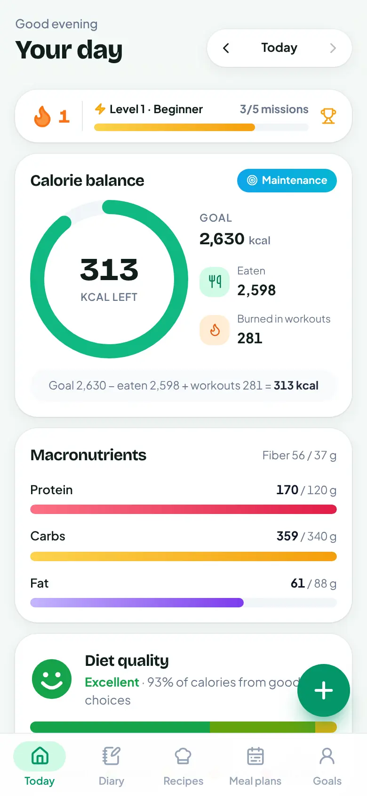
  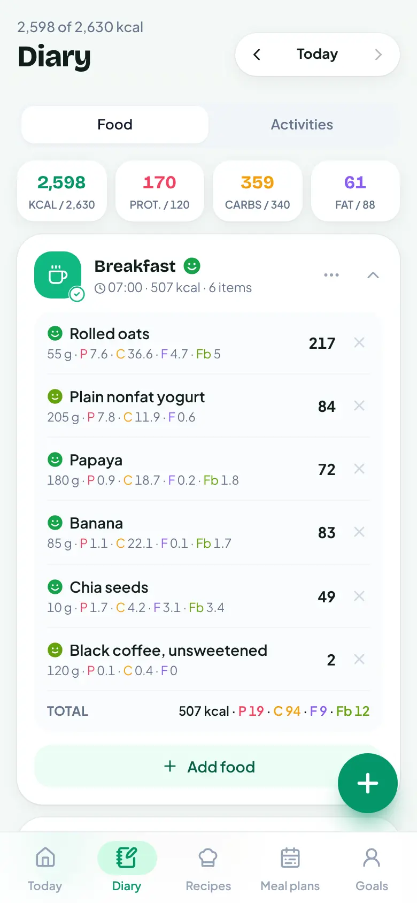
  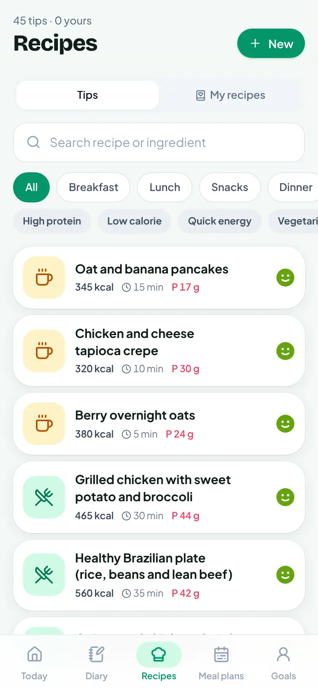
  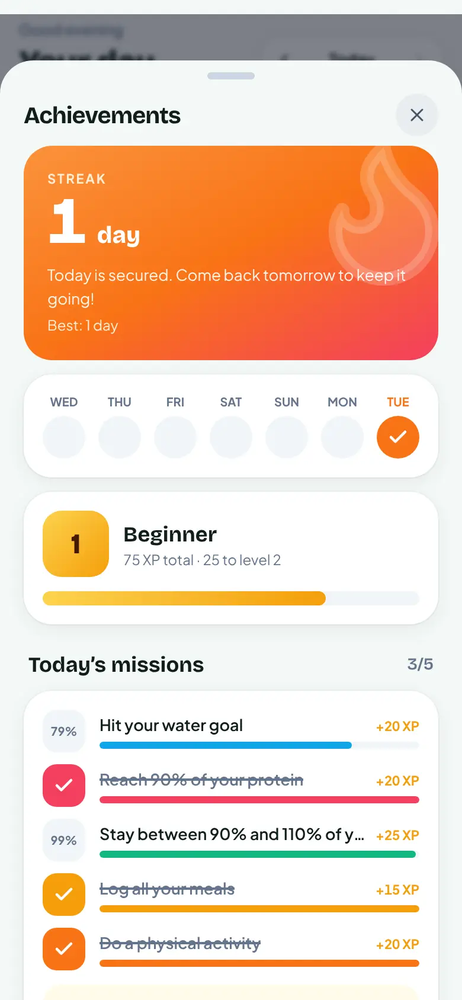
</p>
<p>
  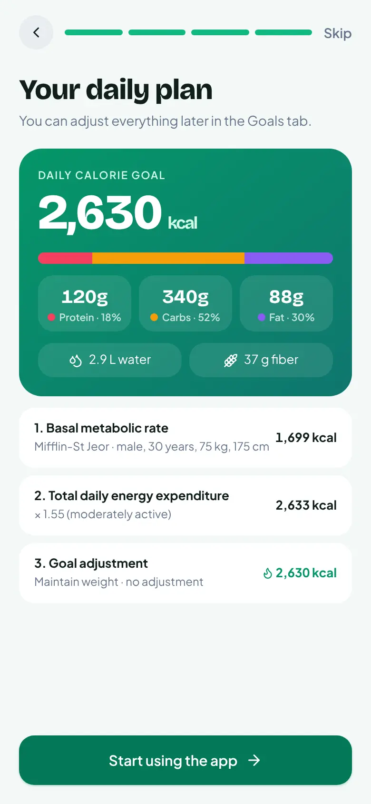
  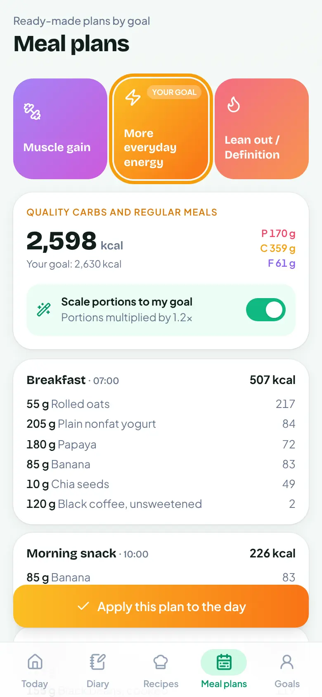
  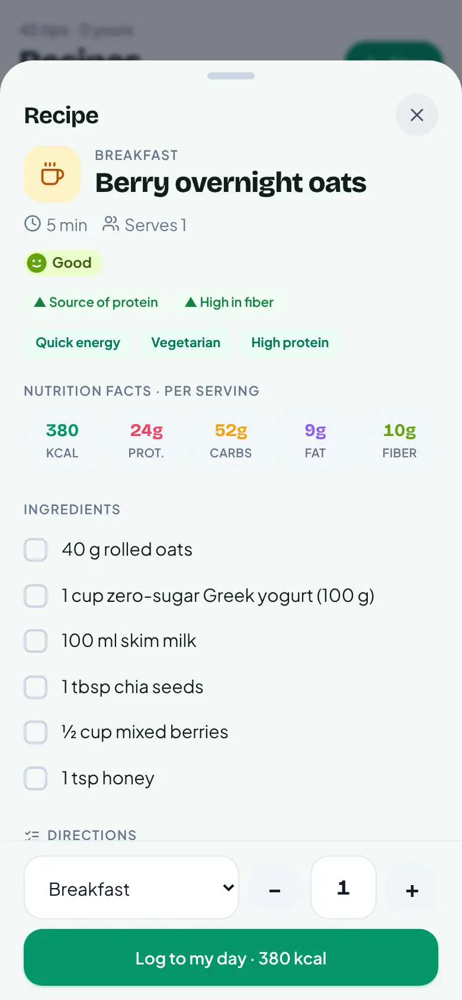
  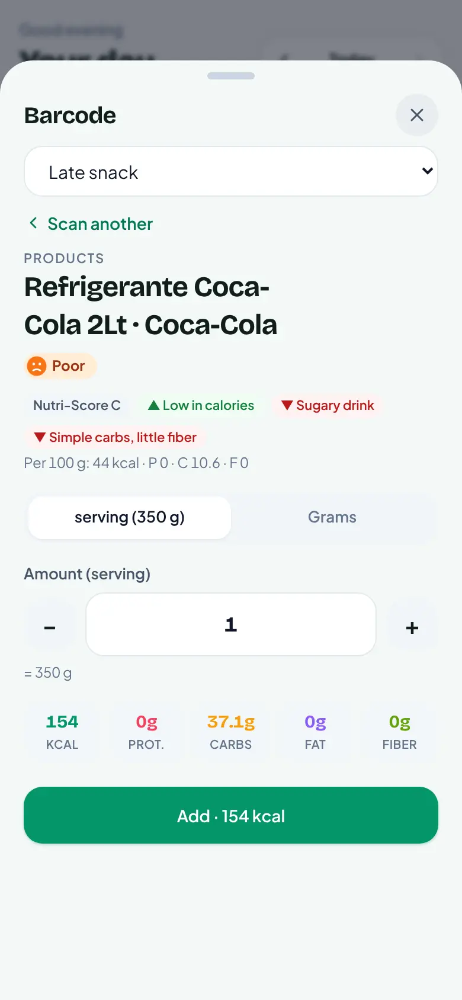
</p>

### Features
- **Automatic goals:** a 3-step setup calculates daily calories (Mifflin-St Jeor BMR × activity factor ± goal adjustment, with a safe minimum), macros (protein in g/kg, fat as a % of calories), water (35 ml/kg) and fiber. Every step of the calculation is shown, and all goals can be set manually.
- **Today:** calorie ring (goal − eaten + workouts), protein/carb/fat bars, animated water glass, meal counter and a 7-day chart.
- **Food diary:** 6 default meals plus custom ones, search across 70+ Brazilian foods (by household portion or grams) and manual entries. Workouts tab with calories burned estimated from METs.
- **Quick add (+ button):**
  - **Meal photo:** the AI identifies the foods and estimates the portions; you review the grams before saving.
  - **Nutri AI:** a chat (text or voice) that logs what you ate, answers questions and suggests meals.
  - **Barcode:** photo or typed code, checked against a **built-in offline database of 25,000 products sold in Brazil** (Open Food Facts). If a product is missing, the AI reads the nutrition label from a photo.
- **Nutritional quality:** faces from Excellent 🟢 to Very poor 🔴 on every food, product, recipe, meal and on the day, with the reasons (high in protein, high in sugar, high in sodium…). Rating order: hand-set grades for basic foods → product Nutri-Score (capped by our own check) → AI grade → nutrient-density formula (`src/lib/quality.js`).
- **Recipes:** 45 recipe tips with filters by meal and goal, plus **My recipes** (with photo; calories calculated from the ingredients, or generated by the AI from an idea).
- **Meal plans:** muscle gain, energy and fat loss, with portions scaled to your calorie goal and applied to the day in one tap.
- **Rewards (Duolingo-style):** 5 daily missions earn XP; completing 3 secures the day and keeps the 🔥 streak. Levels, 12 badges, a weekly calendar and a "streak at risk" warning.

### Turning on the AI
The app ships with **no AI key**. Anyone who wants the AI features uses **their own Claude API key**:
1. Create an account at [console.anthropic.com](https://console.anthropic.com), add credits and create a key under **API Keys**.
2. In the app, go to **Goals → Artificial intelligence**, paste the key and tap **Save and test**.

The key is stored **only on your device** and is sent straight from your browser to the Anthropic API. Usage is billed to your own API account (a meal photo costs about US$ 0.01–0.03).

### Privacy
- There is no sign-up, login or server. Each person's data (meals, water, workouts, profile, recipes) stays **only in their own browser** (localStorage); nobody else can see it, including the repository owner.
- The app makes **no requests to third-party servers**: fonts and the product database are bundled. The only outside calls are the ones you trigger yourself, to the Anthropic API (with your key) or to Open Food Facts for barcodes that are not in the built-in database.

### Tech notes
- **i18n:** Portuguese text is the key and `src/i18n/en.js` translates it, so a missing translation falls back to the original instead of disappearing. Foods and recipes have their own translation files (`src/i18n/foods.en.js`, `src/i18n/recipes.en.js`).
- **Storage:** `src/lib/storage.js` keeps everything on the device and is ready to sync with a remote database (latest edit wins). A Supabase example with SQL lives in `src/lib/adapters/supabase.example.js`.
- **Product database:** `src/data/products-br.json` is generated from the public Open Food Facts export (ODbL license, © Open Food Facts contributors):
  ```bash
  curl -sL https://static.openfoodfacts.org/data/en.openfoodfacts.org.products.csv.gz | gunzip | python3 scripts/build-products.py
  ```

### Run locally
```bash
npm install
npm run dev          # http://localhost:5173
npm run build        # PWA in dist/
npm run build:single # single HTML file in dist-single/
```

---

## Português

App web mobile-first (PWA) de nutrição, hidratação, treinos e metas. Feito com React, Tailwind CSS e Lucide. A interface está completa em **português e inglês**, e o idioma é escolhido automaticamente pelo aparelho; dá para trocar em **Metas → Idioma**.

**Instalar no celular:** no Android, abra o link no Chrome e toque em **⋮ → Instalar app**. No iPhone, abra no Safari e toque em **Compartilhar → Adicionar à Tela de Início**.

<p>
  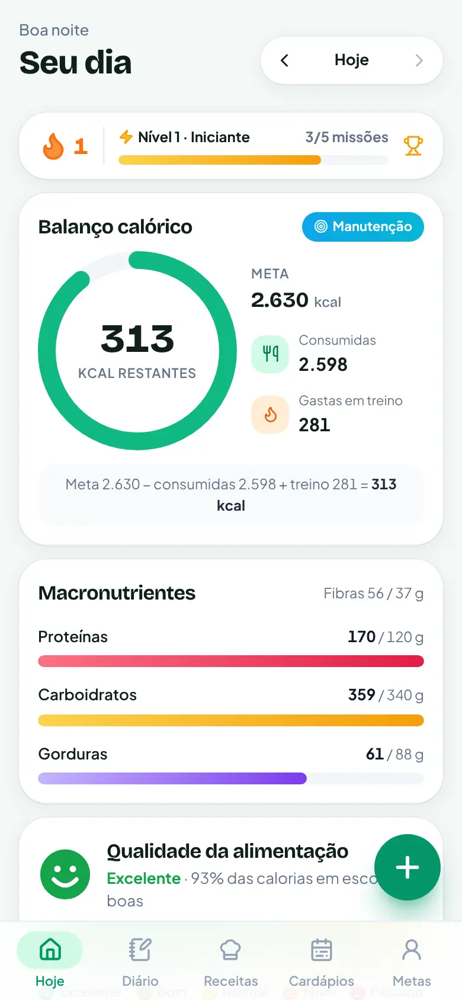
  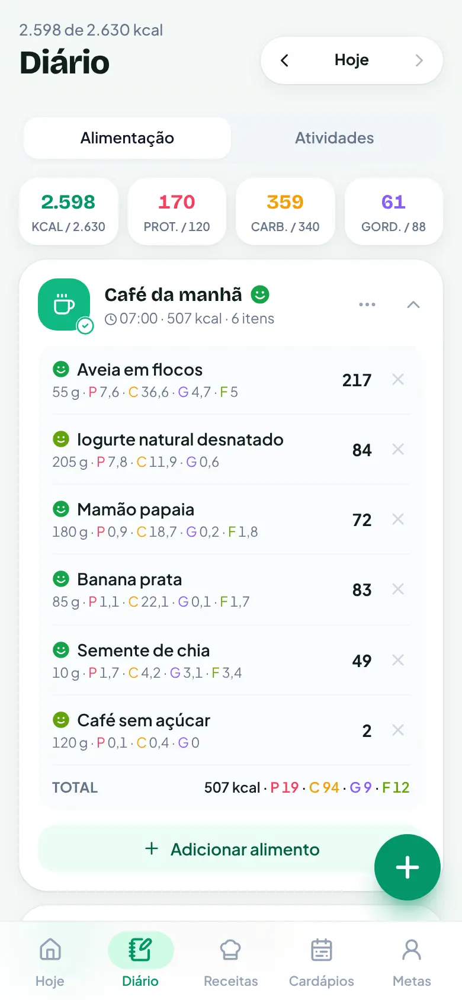
  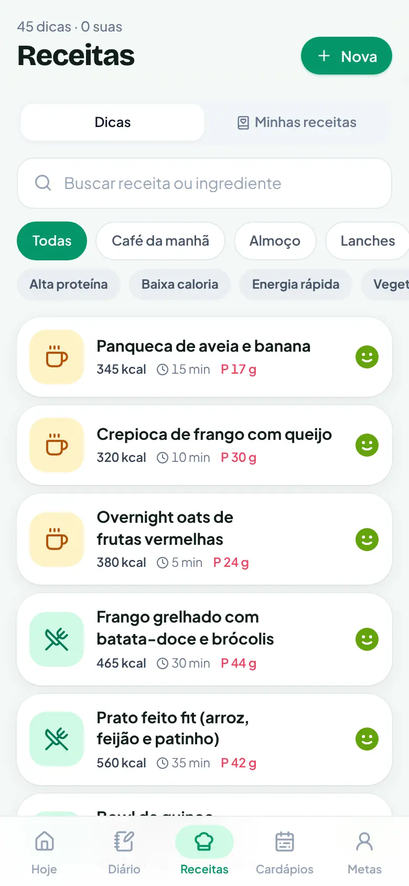
  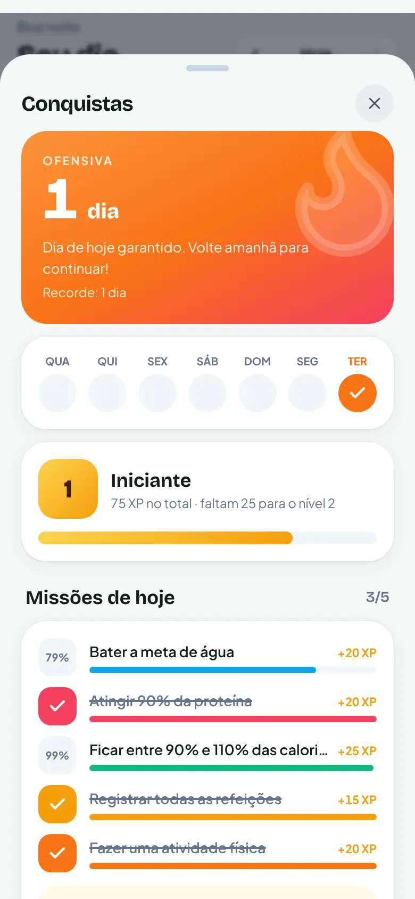
</p>
<p>
  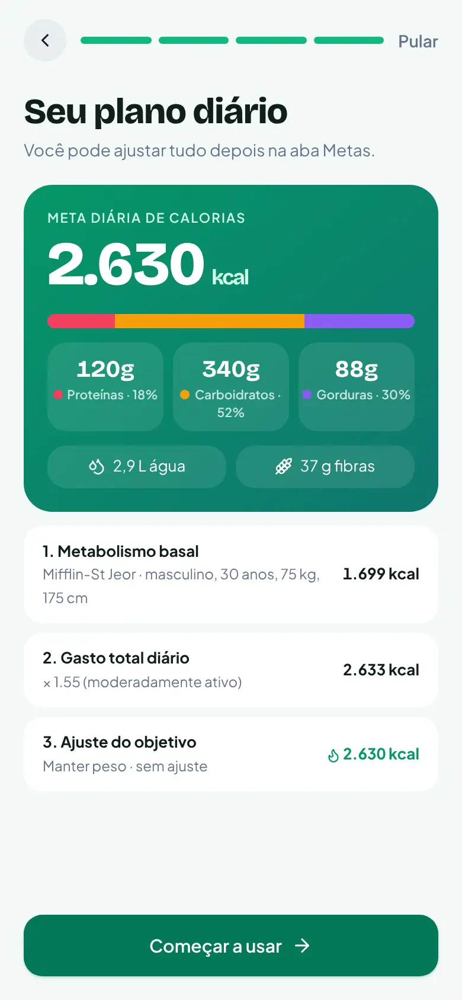
  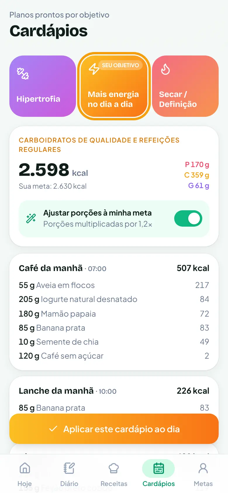
  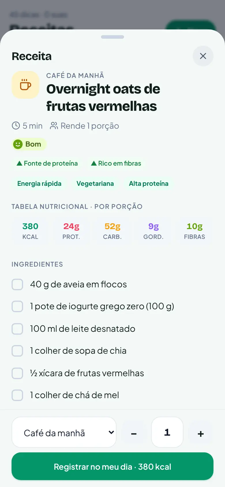
  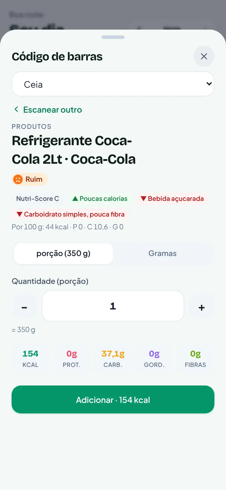
</p>

### Funcionalidades
- **Metas automáticas:** cadastro em 3 passos que calcula as calorias do dia (TMB de Mifflin-St Jeor × fator de atividade ± ajuste do objetivo, com piso de segurança), os macros (proteína em g/kg, gordura em % das calorias), a água (35 ml/kg) e as fibras. O cálculo aparece passo a passo, e tudo pode ser ajustado manualmente.
- **Hoje:** anel de calorias (meta − consumidas + treino), barras de proteínas, carboidratos e gorduras, copo de água animado, contador de refeições e gráfico dos últimos 7 dias.
- **Diário:** 6 refeições padrão e refeições personalizadas, busca em mais de 70 alimentos brasileiros (por porção caseira ou em gramas) e cadastro manual. Aba de atividades com gasto calculado por MET.
- **Registro rápido (botão +):**
  - **Foto do prato:** a IA identifica os alimentos e estima as porções; você confere as gramas antes de salvar.
  - **Nutri IA:** chat por texto ou voz que registra o que você comeu, tira dúvidas e sugere refeições.
  - **Código de barras:** foto ou digitação do código, consultando uma **base offline com 25 mil produtos vendidos no Brasil** (Open Food Facts). Se o produto não estiver na base, a IA lê a tabela nutricional pela foto.
- **Qualidade nutricional:** carinhas de Excelente 🟢 a Péssimo 🔴 em cada alimento, produto, receita, refeição e no dia, com os motivos (rico em proteína, muito açúcar, muito sódio…). Ordem da nota: nota definida à mão para os alimentos básicos → Nutri-Score do produto (limitado pelo cálculo próprio) → nota da IA → cálculo por densidade de nutrientes (`src/lib/quality.js`).
- **Receitas:** 45 dicas de receitas com filtros por refeição e objetivo, além de **Minhas receitas** (com foto; calorias calculadas pelos ingredientes ou geradas pela IA a partir de uma ideia).
- **Cardápios:** hipertrofia, energia e definição, com porções ajustadas à sua meta calórica e aplicação ao dia em um toque.
- **Recompensas (estilo Duolingo):** 5 missões diárias valem XP; cumprir 3 garante o dia e mantém a ofensiva 🔥. Níveis, 12 medalhas, calendário da semana e aviso de ofensiva em risco.

### Como ativar a IA
O app **não traz nenhuma chave de IA**. Quem quiser os recursos de IA usa a **própria chave da API do Claude**:
1. Crie uma conta em [console.anthropic.com](https://console.anthropic.com), adicione créditos e gere uma chave em **API Keys**.
2. No app, vá em **Metas → Inteligência artificial**, cole a chave e toque em **Salvar e testar**.

A chave fica **só no seu aparelho** e vai direto do navegador para a API da Anthropic. O custo é por uso, na sua própria conta da API (uma foto do prato custa em torno de US$ 0,01 a 0,03).

### Privacidade
- Não existe cadastro, login nem servidor. Os dados de cada pessoa (refeições, água, treinos, perfil, receitas) ficam **apenas no navegador do próprio aparelho** (localStorage); ninguém mais vê, nem o dono do repositório.
- O app **não se conecta a servidores de terceiros**: as fontes e a base de produtos vão embutidas. As únicas conexões externas são as que você mesmo aciona: a API da Anthropic (com a sua chave) ou o Open Food Facts, para códigos de barras que não estão na base embutida.

### Notas técnicas
- **Idiomas:** o texto em português é a chave e `src/i18n/en.js` traduz para inglês, então uma tradução que falte volta para o original em vez de sumir. Alimentos e receitas têm arquivos próprios (`src/i18n/foods.en.js`, `src/i18n/recipes.en.js`).
- **Armazenamento:** `src/lib/storage.js` guarda tudo no aparelho e já está pronto para sincronizar com um banco remoto (vence a edição mais recente). O exemplo com Supabase e o SQL estão em `src/lib/adapters/supabase.example.js`.
- **Base de produtos:** `src/data/products-br.json` é gerado a partir do export público do Open Food Facts (licença ODbL, © colaboradores do Open Food Facts), com o comando mostrado na seção em inglês.

### Rodar localmente
```bash
npm install
npm run dev          # http://localhost:5173
npm run build        # PWA em dist/
npm run build:single # HTML único em dist-single/
```
